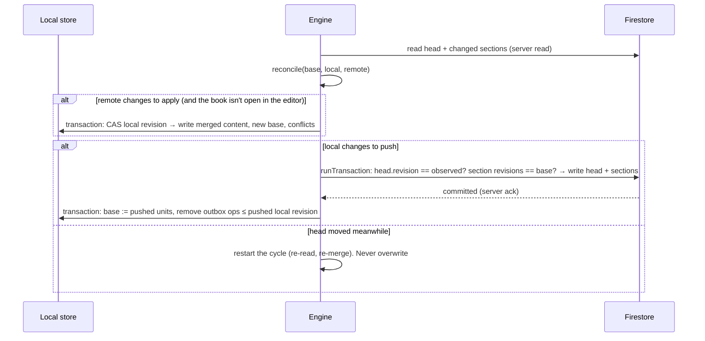

# Sync, autosave, and recovery

Status: M1-C. Offline-first cloud sync against the Firebase **emulator only**. Nothing in this repository talks to a real Firebase project.

Code:

| Where | What |
| --- | --- |
| `packages/sync` | Pure logic with no I/O: splitting a manuscript into sync units, hashing, the three-way reconcile planner, the structure merge, and conflict and resolution types |
| `packages/local-storage` | Device storage (M1-B), plus the sync tables: per-book sync base, durable outbox, and preserved copies |
| `packages/cloud-sync` | The sync engine (queue, backoff, state, conflicts, snapshots), the remote protocol over a small document-store interface, an in-memory document store for tests, and `./firestore` (the Firestore document store) |

## Principles

1. **Local first.** Edits are durably saved on the device (M1-B) before anything else happens. Sync never blocks typing.
2. **Never silently overwrite.**
   - Every remote write is a compare-and-set inside a Firestore transaction, and the security rules independently require `revision == previous + 1`.
   - If both sides changed the same unit, the author decides. There is no last-write-wins.
3. **Small units.** A book syncs as one *structure* unit (metadata, section order, parts) plus one unit per section. Independent edits to different sections never conflict, and an edit to one chapter writes only that chapter.
4. **Atomic, verifiable commits.** A sync commit is one Firestore transaction that writes the book head and the changed sections together. Readers verify every section against the head's index, so a partially written book can't be mistaken for a committed revision.
5. **Recoverable.** Choosing the cloud version, deleting, or restoring first preserves what would be replaced, either as a local preserved copy or a cloud snapshot. Snapshots are taken at milestones and retained under a documented policy.
6. **Synced means server-acknowledged.** Commits use `runTransaction`, which resolves only after the server commits. Reads use server reads (`getDocFromServer`/`getDocsFromServer`). The Firestore SDK uses an in-memory cache only, so a cache write is never reported as synced.

## Firestore data model

Paths keep the M1-A layout (`users/{uid}/manuscripts/{manuscriptId}`). `manuscriptId` equals the local `bookId` and the canonical `Manuscript.id`.

```text
users/{uid}/manuscripts/{bookId}                           book head (one small document)
users/{uid}/manuscripts/{bookId}/sections/{sectionId}      one section, current revision (or tombstone)
users/{uid}/manuscripts/{bookId}/sections/{sectionId}/chunks/{n}   overflow chunks of a very large section (n ≥ 1)
users/{uid}/manuscripts/{bookId}/snapshots/{snapshotId}    snapshot metadata
users/{uid}/manuscripts/{bookId}/snapshots/{snapshotId}/chunks/{n} snapshot content (serialized manuscript), n ≥ 0
```

**Book head:**

| Field | Meaning |
| --- | --- |
| `ownerId` | Path UID; immutable |
| `syncFormat` | `1`. A client refuses a head with a newer format |
| `schemaVersion` | `book-model` schema version of the content. A client refuses newer versions (`unsupported_version`) and leaves them unmodified |
| `revision` | Commit counter. Starts at 1; each commit sets `revision + 1` (enforced by the rules) |
| `structureRevision` | Increments only when the structure changes (rules allow `same` or `+1`) |
| `structure` | JSON string: title, subtitle, authors, language, metadata, `createdAt`, parts, and section order (IDs) |
| `sectionIndex` | JSON string: `{ sectionId: [revision, contentHash, chunkCount] }` for every live section in the order |
| `title`, `wordCount` | Denormalized, for listing |
| `deleted` | Soft delete. Clients cannot hard-delete a head |
| `lastOpId`, `recentOps` | Idempotency: the outbox operation IDs of the last ≤ 20 commits |
| `createdAt`, `updatedAt` | `updatedAt` is the server time (`request.time`) |

**Section:**

| Field | Meaning |
| --- | --- |
| `ownerId`, `manuscriptId`, `sectionId` | Must match the path |
| `revision` | Per-section revision. Starts at 1, `+1` per change (enforced by the rules) |
| `commitRevision` | The head `revision` of the commit that wrote it |
| `contentHash` | `stableHash` of the section object |
| `deleted` | Tombstone: deleting a section keeps the document, so revisions stay monotonic and delete-versus-edit is detectable |
| `chunkCount`, `content` | The section serialized as a JSON **string** (not a map, so Firestore doesn't index every run), split into ≤ 200,000-character chunks. Chunk 0 is inline; the rest are in `chunks/{n}` documents written in the same transaction |

Storing content as strings matters:

- A map with thousands of runs would create thousands of index entries per document (the limit is 40,000).
- Strings over 1,500 bytes are indexed only by their prefix.
- A 200,000-character chunk is at most about 600 KB in UTF-8, safely under the 1 MiB document limit.

**Limits enforced before sending** (a commit over these limits is refused with `too_large`; the local copy stays intact and the error is shown):

- At most 450 document writes per commit.
- At most 9 MiB per commit (Firestore allows 10 MiB per request).
- At most 4,000 sections per book (the head index has to fit in one document).

## Revision semantics

- **Head `revision`:** total order of commits for a book. Every commit compares and sets it: the transaction reads the head and aborts if `revision` differs from what the client merged against.
- **Section `revision`:** changes only when that section's content changes, or when it is tombstoned or revived. The device keeps, per section, the `revision` and `contentHash` it last saw from the server (its *base*).
- **`structureRevision`:** the same for the structure unit.
- A unit **changed locally** when its current hash differs from the base hash. It **changed remotely** when the remote revision differs from the base revision.

| Local changed | Remote changed | Result |
| --- | --- | --- |
| no | no | nothing |
| no | yes | pull |
| yes | no | push (compare-and-set on the base revision) |
| yes | yes, same hash | converge (adopt the remote revision; not a conflict) |
| yes | yes, different | **conflict** (edit/edit, local delete vs remote edit, local edit vs remote delete) |

The structure unit is merged three-way instead of conflicting whenever that is safe and lossless:

- Metadata fields merge per field.
- If only one side reordered, that order is kept, and sections added on the other side are inserted after their nearest preceding neighbour.
- Parts merge if only one side changed them.

Concurrent reorders, or different values for the same metadata field, are a **structure conflict**.

## Sync cycle (per book)



- **Phase 1 (pull/merge)** writes only local data, and only if the local revision is still the one the merge was computed from. If the author typed meanwhile, the cycle restarts. Remote changes are not applied to a book that is open in the editor (the editor would otherwise see `stale_revision`); they are applied when it closes. Pushes continue meanwhile.
- **Phase 2 (push)** sends only units whose local hash differs from the base, compared and set against the observed head revision and each section's base revision. On success, only the pushed units' base entries move forward. Edits typed during the network round trip stay "changed locally" and go in the next cycle, so nothing pulled can be reverted and nothing typed can be lost.
- Conflicted units are never pushed. The pushed structure keeps the remote position of a section that is in conflict, so the remote book never references content it doesn't have.

## Durable outbox

- Every local `create`/`save` appends an outbox row `{opId, bookId, localRevision, createdAt}` **in the same transaction** as the content. Deleting a synced book appends a `deleteBook` row in the same transaction as the local delete.
- The engine processes books one at a time, in outbox order. A cycle syncs the book's latest content and then removes every op with `localRevision ≤` the pushed revision.
- The newest op's ID is the commit's `opId`. If a commit landed but the acknowledgement was lost (network failure after commit), the retry finds `opId` in `recentOps` or finds identical hashes. Either way the commit is not repeated and no revision is created twice.
- **Failures:**
  - Retryable failures (`unavailable`, `deadline-exceeded`, `aborted`, `resource-exhausted`, `internal`, a remote changing mid-read) back off exponentially: 1 s, 2 s, 4 s, … up to 5 min, with jitter. `attempts` and `nextAttemptAt` are persisted.
  - Permanent failures (`too_large`, invalid or unsupported data, `invalid-argument`) stop retrying for that book and show **Sync failed** with the reason and a Retry button. The op is kept.
  - `permission-denied` or an `unauthenticated` session pauses the engine (the account is probably signed out).
- Ops are never dropped. They survive reloads, restarts, emulator restarts, and sign-out, because they live in SQLite or IndexedDB, keyed by owner UID.

## Accounts

- An engine is created for one UID with that UID's `UserLibrary` and a remote bound to `users/{uid}`. The apps create it inside the UID-keyed signed-in tree, so signing out stops it. Signing in as someone else creates a new engine over that account's library only.
- Before every remote operation the remote checks that the Firebase Auth `currentUser.uid` still equals the engine's UID. On a mismatch, it stops without writing.
- The rules independently reject any write to `users/{other}`.
- Stopping waits for an in-flight commit to settle. A commit that was already sent can only land in its own account's documents.

## Sync states (per book)

| State | When |
| --- | --- |
| Saved locally | Has unsynced changes; the engine isn't running (no session or no cloud configuration) |
| Waiting to sync | Unsynced changes queued (debounce or backoff) |
| Syncing | A cycle for this book is in flight |
| Synced | No queued ops, no conflicts; the base equals the current local content, confirmed by a server commit or read |
| Conflict detected | At least one unresolved conflict |
| Sync failed | A permanent failure, or the last attempt failed (shown with the message; transient failures keep retrying) |
| Offline | The network monitor reports offline, or the last attempt failed with `unavailable` |

The local autosave status (Saved / Saving / Unsaved changes / Save failed) stays separate. It only describes the device write.

## Conflicts

A conflict record holds the unit, both versions (remote content as fetched, local hash at detection), the remote revision, and the detection time. It is stored in the book's sync state, so it survives restarts. Resolving it:

| Kind | Keep mine | Keep theirs | Keep both |
| --- | --- | --- | --- |
| Section edited on both | Base := remote revision; push mine (compare-and-set) | Preserve my section as a local copy; adopt theirs | Theirs keeps the original ID; mine becomes a new section (new ID, title "… (my version)") right after it |
| I edited, they deleted | Revive the tombstone with my content | Preserve my section as a copy; accept the deletion | Mine as a new section; the deletion stands |
| I deleted, they edited | Preserve their section as a copy; push the deletion | Re-add their section where they have it | Same as keep theirs (nothing of mine to keep) |
| Structure (concurrent reorders or metadata) | Push my order and fields; sections added remotely stay (inserted by their position) | Preserve my structure as a copy; adopt theirs; sections I added stay | Not offered: both orders already contain every section |

- Resolution is a local transaction that checks the conflict is unchanged: the same remote revision, and a local version that hasn't changed since the screen opened. If either changed, the screen refreshes instead of applying. The result is pushed by the normal compare-and-set path. If the cloud changed again in the meantime, a new conflict is raised, so a resolution is never applied against a version the author didn't see.
- Conflicting content stays in local storage (current content, the conflict record, and preserved copies) until the resolution is durably committed. Retrying a resolution is safe: an already-resolved conflict is a no-op.

## Snapshots

- A snapshot is a full serialized manuscript, stored as chunk documents plus a metadata document (`headRevision`, `contentHash`, word and section counts, reason, server `createdAt`). It is written in one batched write, so it either exists completely or not at all.
- **Milestones:** the initial upload, before restoring (the current cloud state), before a conflict resolution that replaces cloud content, periodically (at most one every 6 hours per book, after a successful sync), and manual.
- **Restore:**
  1. Requires the book to be fully synced: no queued ops and no conflicts.
  2. Takes a `beforeRestore` snapshot of the current state.
  3. Writes the snapshot's content as a new local revision.
  4. Pushes it through the normal compare-and-set path, so it can't overwrite cloud changes it didn't see.
- **Retention (client-enforced after each snapshot):** keep the newest 20 `periodic`/`initialUpload`/`manual` snapshots. Keep `beforeRestore`/`beforeConflictResolution` snapshots for 30 days, and always the newest 10 of them.
- **Cost:** a 210k-word book is about 1.4 MB per snapshot. With 20 milestone snapshots, about 28 MB per large book. At Firestore's list price (about US$0.18/GB-month at the time of writing) that is about US$0.005 per month, plus about 4 writes per snapshot.

## Server-side enforcement

See `firebase/firestore.rules` and `docs/architecture/system-design.md` ("Security rules").

- Owner-only paths, with an immutable `ownerId`.
- Head and section revisions must increase by exactly 1. Stale writes are rejected even from a modified client.
- No client hard-deletes of heads or sections.
- Snapshots are immutable.
- Field allow-lists, with no client access to entitlements, billing, quotas, or admin data.
- Default deny.

## Verification

| Layer | What runs | Where |
| --- | --- | --- |
| Pure logic | 24 tests: reconcile, structure merge (reorders on both sides), push planning, every conflict kind × choice | `packages/sync/src/reconcile.test.ts` |
| Engine | 27 tests against `MemoryBackend` (enforces the same invariants as the rules, with fault injection before/after commit): two devices, the acceptance scenario, Keep mine/theirs/both, a change while the screen is open, stale merges, delete-vs-edit, reorder-vs-edit, book deletion, restart with a queued op, lost acknowledgement, offline + backoff, partial/damaged reads, unsupported format, too-large commits, chunking, editor deferral, snapshot restore and retention, wrong account / sign-out / account switch | `packages/cloud-sync/src/engine.test.ts` |
| Local tables | Outbox, sync state, preserved copies, real v1 → v2 upgrades on SQLite and IndexedDB | `packages/local-storage/src/sync-tables.test.ts`, driver tests |
| Rules | Head/section/chunk/snapshot invariants, forged owners, stale and skipped revisions, hard deletes, client-chosen server times, entitlements/billing/admin | `firebase/tests/firestore.rules.emulator.test.ts` |
| Real SDK, two clients | Two Firebase apps signed in to one account (SQLite device + IndexedDB device), `disableNetwork()` for offline: upload/download/merge, the acceptance scenario, rules rejecting stale/skipped revisions and deletes from a modified client, cross-account isolation, sign-out pause and resume, snapshots, a chunked 450k-character section, the 210k-word fixture | `packages/cloud-sync/src/sync.emulator.test.ts` |
| Real browser | Two isolated Chrome sessions on two origins against the emulators and a production build | Manual script (see below) |

**210k-word fixture against the Firestore emulator** (`very-large-manuscript`: 210,838 words, 70 sections, about 1.48 M characters, local machine, emulator on localhost):

| Step | Time |
| --- | --- |
| Initial upload (one transaction, plus the `initialUpload` snapshot) | ~370 ms |
| Download and assemble on the second device | ~100 ms |
| Push after editing one section | ~60 ms |
| Reconcile that change on the other device | ~60 ms |

The downloaded text is identical to the original (plain text and section-level equality). No limit was hit: 70 section writes is well under 450, and no section of this fixture exceeds the 200k-character chunk size (chunking is covered by the dedicated 450k-character test). Emulator timings exclude real network latency.

**Real-browser run (two sessions):** device A (`localhost`) signs up and creates a manuscript; device B (`127.0.0.1`, separate browser context) signs in and receives it. B opens it, goes offline (Chrome network emulation) and rewrites the paragraph: the editor shows "Saved" and "Offline". A rewrites the same paragraph online and syncs. B reconnects while still in the editor: status becomes "Conflict detected" and B's text stays on screen untouched. The conflict screen shows both versions labelled "Your version (this device)" and "Other device's version (cloud)"; Keep both resolves it; both devices then show "Synced", and the cloud copy contains both paragraphs. A manual snapshot is listed afterwards. Not run on a native simulator or device.

## Known limitations

- Very large single commits are refused rather than split: more than 450 changed sections, or more than 9 MiB. An example is restoring a snapshot of a book with thousands of sections. The local copy is unaffected.
- The minimal editor locks remote pulls for the open book until it is closed. Real-time co-editing is out of scope.
- Native network status isn't observed (no NetInfo dependency). Offline is inferred from failed attempts, and retries happen on foreground and on backoff.
- The web app has no service worker, so navigating to a page that isn't already loaded fails while offline. Editing an open manuscript offline works and syncs on reconnect (verified in the browser run); an offline app shell is future work.
- Retention is enforced by the client after each snapshot. A client that never runs again leaves its snapshots in place; server-side cleanup needs a scheduled function.
- Not verified on an iOS/Android simulator or physical device. The Expo exports compile the sync code, but SQLite-backed sync and Firestore long polling on React Native are untested on hardware.
