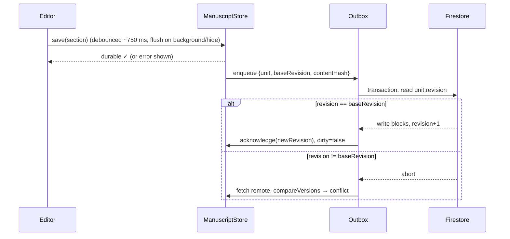

# Sync, autosave, and recovery

Status: the decision logic and interfaces are in `packages/sync`. M1-A added the Firestore and Storage security rules this design relies on (see "Server-side enforcement"). The sync client itself comes in a later milestone, and nothing writes to production Firebase.

## Server-side enforcement (M1-A rules)

The rules in `firebase/firestore.rules` back the principles below, so a buggy or malicious client can't bypass them:

- A manuscript or section is created at `revision == 1`, and each update must set `revision == resource.revision + 1`. A write based on a stale revision is rejected. The outbox should still use a transaction (read, compare, write) so it gets a clean conflict instead of a permission error.
- Snapshot documents can't be updated, only created or deleted. Snapshot files in Storage can't be overwritten.
- `ownerId` is fixed at creation, and every path is scoped to `users/{uid}`, so sync can never write into another account.

## Principles

1. **Local first.** Edits are saved to the device store (SQLite on native, IndexedDB on web) before the UI shows "Saved". A failed save is shown to the author and retried. It is never swallowed.
2. **Never silently overwrite.** Every remote write is conditional on the revision it was based on. If the server has moved on, the client gets a conflict, not a successful overwrite.
3. **Small sync units.** The manuscript manifest (metadata, section order, parts) and each section sync independently. Editing chapter 12 on a phone while fixing a typo in chapter 3 on the web is not a conflict.
4. **Recoverable.** A snapshot is taken before every risky operation: import, conflict resolution, and restore.

## Data per sync unit

| Field | Where | Meaning |
| --- | --- | --- |
| `revision` | server | Integer, incremented by the server transaction on each accepted write |
| `contentHash` | both | `stableHash(unit)`: canonical-JSON cyrb53 fingerprint |
| `baseRevision` | device | Last server revision this device saw for the unit |
| `dirty` | device | Local edits not yet acknowledged |

## Decision table (`compareVersions`)

| Local dirty? | Remote vs base | Result |
| --- | --- | --- |
| no | equal | `inSync` |
| no | ahead | `pull` |
| yes | equal | `push` with `expectedRevision = base` |
| yes | ahead, same hash | `pull` (identical edits; not a conflict) |
| yes | ahead, different hash | **`conflict` (`bothChanged`)** |
| any | behind base | **`conflict` (`remoteRewound`)**: server restore or data loss; never auto-resolve |

## Write path

## Conflict handling

- Keep **both** versions. Snapshot the local copy (`beforeConflictResolution`), then show the author a side-by-side choice for the section: keep mine, keep theirs, or keep both as separate sections.
- Manifest conflicts are resolved structurally, never by overwriting:
  - A section added on one device and moved on another keeps both changes.
  - A section deleted on one device and edited on another gets restored, with a notice to the author.
- Conflicts are never resolved automatically by timestamp. Device clocks are unreliable.

## Autosave and recovery UX

- The status reads **Saved on this device**, **Synced**, **Offline: changes will sync**, or **Couldn't save** (with a retry action).
- Snapshots are kept per manuscript. Retention: the last 20 automatic snapshots, plus every pre-import and pre-conflict snapshot for 30 days (provisional).
- "Restore" creates a new revision from the snapshot. History is never rewritten.

## Legacy migration

When a 2.0 web client starts on an origin that has a `folio-loom:book` localStorage entry, it runs `fromLegacyBook`. If the text-preservation report is `ok`, it saves the result as a new manuscript and keeps the legacy key untouched until the author confirms the migration.
