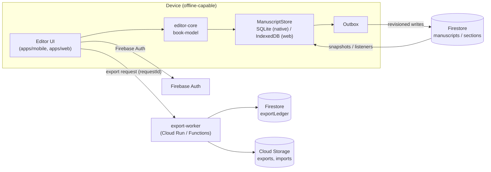

# Folio Loom 2.0 system design

## Goals

These constraints are fixed:
- Phone-first native iOS and Android apps, plus a responsive web app.
- Accounts are mandatory, cloud sync works from launch, and editing works offline after sign-in.
- DOCX and TXT import, with automatic chapter detection that the author can correct.
- Editing of chapters, paragraphs, and inline formatting.
- Professional templates.
- EPUB 3 export and print-ready PDF export.
- A limited number of free exports, with unlimited exports on Pro.
- Secure ownership, autosave, and recovery.

Manuscript integrity takes priority over interface polish.

## Repository layout

The repository is an npm-workspaces monorepo. The legacy CRA app stays at the repository root until 2.0 replaces it; see ADR-001.

```text
apps/
  mobile/            Expo + React Native (iOS, Android)
  web/               Next.js App Router (responsive web)
packages/
  book-model/        Versioned canonical schema (zod), builders, serialization, plain-text views
  chapter-engine/    Chapter / part / front & back matter detection with provenance
  import-engine/     TXT import, legacy-book migration; `./docx` subpath (Mammoth) for DOCX
  validation/        Integrity checks, text-preservation checks, provisional import limits
  editor-core/       Pure immutable edit operations (move section, edit blocks, parts)
  formatting/        Trim sizes, printer-safe margins, typography settings
  export-epub/       XHTML generation and escaping (EPUB packaging next milestone)
  export-contracts/  Export request / ledger types and the allowance policy
  sync/              Revision comparison, content hashing, persistence + outbox interfaces
services/
  export-worker/     Server-side export admission + idempotent accounting
qa/fixtures/         Small → very large DOCX/TXT manuscripts used by tests
tooling/             Shared tsconfig, Vitest config
```

Dependencies flow in one direction:

- `book-model` depends on nothing internal.
- `chapter-engine` depends on `book-model`.
- `import-engine` depends on `chapter-engine` and `validation`.
- The apps depend on any of the packages above.

Packages ship TypeScript source. The web app compiles them through `transpilePackages`, and Metro compiles them directly. Nothing under `packages/` may import React, React Native, DOM APIs, or Node-only modules, with one exception: `import-engine/docx`, which pulls in Mammoth. The mobile app must not import that subpath.

## Runtime architecture



- **Auth:** Firebase Auth with email, Apple, and Google sign-in. Every document lives under `users/{uid}/…`, and security rules restrict access to the owning `uid`.
- **Local first:** the editor reads and writes the local `ManuscriptStore` only. Each save is durable before the UI shows it as saved. If a save fails, the UI says so; it is never ignored, which is where the legacy app went wrong.
- **Sync:** an outbox pushes changed units (the manuscript manifest or a single section) with the revision they were based on. See `sync-design.md`.
- **Import:**
  - TXT is imported on the device.
  - DOCX is imported in the web app and in the export/import worker. Native apps upload the file to Storage for server-side conversion until a native DOCX path is proven.
  - Every import runs a text-preservation check before anything is saved. An import that fails the check is not saved.
- **Export:** always server-side. The worker admits the request against the ledger (idempotent on `requestId`), renders from a specific revision, and stores the artifact. See `export-policy.md`.

## Key decisions

| Decision | Choice | Why |
| --- | --- | --- |
| Monorepo | npm workspaces, legacy app stays at root | No new package manager; Vercel config untouched; legacy keeps deploying |
| Schema | zod 4 strict objects, `schemaVersion` literal, migrations registry | Runtime validation on every load/sync boundary; unknown fields rejected, not silently stripped |
| Text model | Sections, then blocks, then runs with marks | Supports inline formatting, scene breaks, subheadings; diffable per section |
| IDs | Prefixed random IDs (`sec_…`, `blk_…`) | Stable across edits, reorders and devices; Firestore-safe |
| Lint | Biome (new dirs only) | Avoids replacing CRA's ESLint 8 binary in the hoisted root |
| Tests | Vitest 5 from `tooling/` | Fast, ESM-native, runs package tests against real fixtures |
| PDF | Server-side renderer (decision in export-policy.md) | Vector text, embedded fonts, correct trim and bleed; DOM pagination doesn't scale |

## Security baseline

- No credentials in the repo. `.gitignore` blocks service-account JSON, `google-services.json`, and `GoogleService-Info.plist`. Config comes from environment variables or EAS secrets.
- Firestore rules: owner-only reads and writes. Export ledger documents are written only by the server, never by clients.
- No HTML is ever stored. Rendering escapes all text (`export-epub/escapeXml`).
- Import limits are enforced before parsing (`validation/IMPORT_LIMITS`, provisional).
