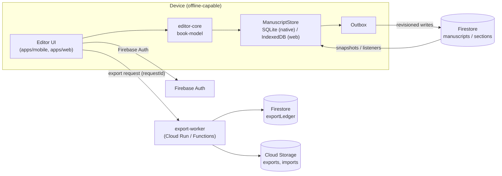
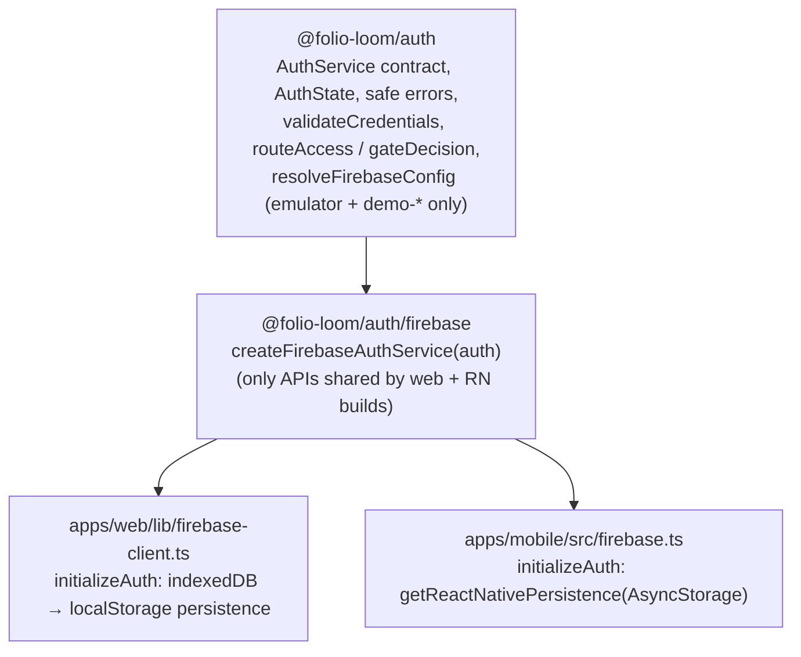
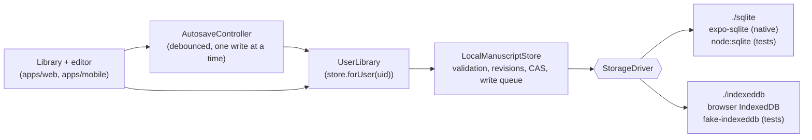

# Folio Loom 2.0 system design

## Goals

These constraints are fixed:
- Phone-first native iOS and Android apps, plus a responsive web app.
- Accounts are mandatory, cloud sync works from launch, and editing works offline after sign-in.
- DOCX and TXT import, with automatic chapter detection that the author can correct.
- Editing of chapters, paragraphs, and inline formatting.
- Professional templates.
- EPUB 3 export and print-ready PDF export.
- A limited number of free exports, with unlimited exports on Pro.
- Secure ownership, autosave, and recovery.

Manuscript integrity takes priority over interface polish.

## Repository layout

The repository is an npm-workspaces monorepo. The legacy CRA app stays at the repository root until 2.0 replaces it; see ADR-001.

```text
apps/
  mobile/            Expo + React Native (iOS, Android)
  web/               Next.js App Router (responsive web)
packages/
  book-model/        Versioned canonical schema (zod), builders, serialization, plain-text views
  chapter-engine/    Chapter / part / front & back matter detection with provenance
  import-engine/     TXT import, legacy-book migration; `./docx` subpath (Mammoth) for DOCX
  validation/        Integrity checks, text-preservation checks, provisional import limits
  editor-core/       Pure immutable edit operations (move section, edit blocks, parts)
  formatting/        Trim sizes, printer-safe margins, typography settings
  export-epub/       XHTML generation and escaping (EPUB packaging next milestone)
  export-contracts/  Export request / ledger types and the allowance policy
  sync/              Pure sync logic: per-unit hashing, three-way reconcile, structure merge,
                     push planning, conflict resolution (no I/O)
  cloud-sync/        Sync engine, Firestore protocol (`RemoteBooks`), in-memory backend for
                     tests; `./firestore` adapts a Firestore client; shared conflict wording
  auth/              Auth contract, safe errors, credential checks, route gate, emulator-only
                     config; `./firebase` subpath adapts a Firebase `Auth` instance
  local-storage/     Offline, account-scoped manuscript store, revisions, recovery, autosave;
                     `./sqlite` and `./indexeddb` drivers (no platform imports in shared code)
services/
  export-worker/     Server-side export admission + idempotent accounting
firebase/            firestore.rules, storage.rules, emulator test suites, test-only emulator config
qa/fixtures/         Small → very large DOCX/TXT manuscripts used by tests
tooling/             Shared tsconfig, Vitest configs, Firebase CLI + emulator scripts
```

Dependencies flow in one direction:

- `book-model` depends on nothing internal.
- `chapter-engine` depends on `book-model`.
- `import-engine` depends on `chapter-engine` and `validation`.
- The apps depend on any of the packages above.

Packages ship TypeScript source. The web app compiles them through `transpilePackages`, and Metro compiles them directly. Nothing under `packages/` may import React, React Native, DOM APIs, or Node-only modules, with one exception: `import-engine/docx`, which pulls in Mammoth. The mobile app must not import that subpath.

## Runtime architecture



- **Auth:** Firebase Auth. M1-A ships email/password against the emulator; Apple and Google sign-in come later. Every document lives under `users/{uid}/…`, and security rules restrict access to the owning `uid`. See "Authentication" below.
- **Local first:** the editor reads and writes the local store only (`@folio-loom/local-storage`: SQLite on native, IndexedDB on the web). Each save is durable before the UI shows it as saved. If a save fails, the UI says so; it is never ignored, which is where the legacy app went wrong. See "Offline manuscript storage" below.
- **Sync (M1-C):** every local save also queues a durable outbox op in the same transaction. A per-account `SyncEngine` reconciles each book three ways (base, local, cloud), then commits only the changed units (book structure, individual sections) in one Firestore transaction with compare-and-set on every revision. Conflicts are recorded, never auto-resolved by time. See `sync-design.md`.
- **Import:**
  - TXT is imported on the device.
  - DOCX is imported in the web app and in the export/import worker. Native apps upload the file to Storage for server-side conversion until a native DOCX path is proven.
  - Every import runs a text-preservation check before anything is saved. An import that fails the check is not saved.
- **Export:** always server-side. The worker admits the request against the ledger (idempotent on `requestId`), renders from a specific revision, and stores the artifact. See `export-policy.md`.

## Key decisions

| Decision | Choice | Why |
| --- | --- | --- |
| Monorepo | npm workspaces, legacy app stays at root | No new package manager; Vercel config untouched; legacy keeps deploying |
| Schema | zod 4 strict objects, `schemaVersion` literal, migrations registry | Runtime validation on every load/sync boundary; unknown fields rejected, not silently stripped |
| Text model | Sections, then blocks, then runs with marks | Supports inline formatting, scene breaks, subheadings; diffable per section |
| IDs | Prefixed random IDs (`sec_…`, `blk_…`) | Stable across edits, reorders and devices; Firestore-safe |
| Lint | Biome (new dirs only) | Avoids replacing CRA's ESLint 8 binary in the hoisted root |
| Tests | Vitest 5 from `tooling/` | Fast, ESM-native, runs package tests against real fixtures |
| PDF | Server-side renderer (decision in export-policy.md) | Vector text, embedded fonts, correct trim and bleed; DOM pagination doesn't scale |

## Authentication



- **One contract, two platform setups.** Each app creates its own `Auth` with the right persistence and connects it to the emulator. The shared adapter only wraps `onAuthStateChanged`, sign-up, sign-in, and sign-out. The web app never imports React Native modules. The mobile app imports `getReactNativePersistence` from `@firebase/auth`, which Metro resolves to the package's `react-native` build. TypeScript can't select that build on its own (the package lists `types` before the `react-native` condition), so `apps/mobile/tsconfig.json` maps `@firebase/auth` to the RN declarations.
- **Persistence, verified rather than assumed:**
  - Web: IndexedDB, falling back to localStorage. Verified in a browser against `next dev` and the Auth emulator: register, reload (still signed in), sign out, reload (still signed out).
  - Native: `@firebase/auth` 1.13.7's RN persistence accepts async-storage `^2.2.0 || ^3.0.0` (Expo SDK 57 pins 2.2.0). `rn-session-restoration.emulator.test.ts` drives the RN build through sign-up, a simulated app restart (restored), sign-out, and another restart (signed out). The iOS export bundle contains `getReactNativePersistence` and not the browser IndexedDB store.
  - Not yet verified on a simulator or physical device. That needs Xcode or Android Studio.
- **States.** `loading` until Firebase reports the restored session, then `signedIn`, `signedOut`, or `error`. The UI never treats `loading` as signed out or signed in.
- **Gate.** `routeAccess` classifies paths: `/projects/**` and `/manuscripts/**` are private; `/sign-in` and `/sign-up` are guest-only. `gateDecision` maps state and access to show-loading, show-error, redirect, or render.
  - On the web, private screens are client components rendered through a function child only once the state is `signedIn`. The server snapshot is always `loading`, so prerendered HTML and the RSC payload contain the loading view, never manuscript content. Don't pass server-rendered private content as `children` to `RequireAuth`, because it would be serialized into the RSC payload.
  - The Expo app's only screen is private and goes through the same `gateDecision`.
- **Errors.** Firebase error codes map to a fixed set of messages. Wrong password, unknown account, and similar errors share one message, so the form doesn't reveal which emails are registered. Raw SDK messages are never shown.
- **`?next=` redirect** accepts only same-site paths (`/x`, not `//host` or absolute URLs).

## Security rules

Rules live in `firebase/` and are tested against the emulators (`npm run ws:test:emulators`).

**Firestore data model** (all client-visible data under `users/{uid}`):

| Path | Client access (only when `request.auth.uid == uid`) |
| --- | --- |
| `users/{uid}` | get, create, update `displayName`/`updatedAt` only. No delete; account deletion is a server flow that must also remove Storage files |
| `…/manuscripts/{id}` (head) | get, list, create (revision 1, structureRevision 1, not deleted), update (revision + 1; structureRevision same or + 1; `createdAt` immutable; no `schemaVersion` downgrade). No delete: deletion is a soft `deleted: true` commit |
| `…/manuscripts/{id}/sections/{id}` | get, list, create (revision 1), update (revision + 1). `manuscriptId`/`sectionId` must match the path. No delete: removal is a tombstone (`deleted: true`, empty content) |
| `…/sections/{id}/chunks/{n}` | get, list, create, update, delete. Path-consistent `index`, owner-only; content is only trusted when the section's hash matches |
| `…/manuscripts/{id}/snapshots/{id}` | get, list, create, delete. Never update; `createdAt` must be the server time; `storagePath`, if present, must point inside the owner's own snapshot folder |
| `…/snapshots/{id}/chunks/{n}` | get, list, create, delete. Never update |
| `…/entitlements/*`, `…/exportLedger/*`, `…/exports/*` | get, list only. Written by trusted servers (Admin SDK) |
| `billing/**`, `admin/**`, anything else | Denied |

- Every client-writable document has an `ownerId` equal to the path `uid`, checked on create, and it can't be changed on update.
- Documents use `keys().hasOnly([...])` allow-lists, so clients can't add `plan`, `isPro`, `isAdmin`, quota counters, or other unknown fields.
- There are no collection-group rules, so cross-account queries are denied.
- The `revision` rules back the sync design: a write based on a stale revision (or one that skips a revision) is rejected, never merged. Tested from the rules suite and from two real SDK clients (`packages/cloud-sync/src/sync.emulator.test.ts`).
- `updatedAt` on heads and sections, and `createdAt` on snapshots, must equal `request.time` (`serverTimestamp()`), so clients can't backdate or forward-date them.
- **Why section rules don't `get()` the parent head:** a sync commit writes the head plus up to 450 sections in one transaction, and Firestore allows at most 20 document-access calls (`get`/`exists`) per request evaluation in a batch. A per-section `get()` would cap commits at about 20 sections. Ownership is instead enforced by the path (`users/{uid}`) plus `ownerId == uid`, and `manuscriptId`/`sectionId` must match the path. A section written without a matching head is unreachable by the protocol: clients only read sections listed in the head's `sectionIndex`, with matching revision and hash.

**Storage paths:**

| Path | Client access (owner only) |
| --- | --- |
| `users/{uid}/imports/{file}` | get, list, create (DOCX ≤ 50 MB or `text/plain` ≤ 20 MB, non-empty), delete |
| `users/{uid}/manuscripts/{id}/snapshots/{file}` | get, list, create (`application/json` or `application/gzip` ≤ 25 MB), delete |
| `users/{uid}/exports/{exportId}/{file}` | get, list only. The export worker writes these |
| anything else | Denied |

- Uploads must carry `customMetadata.ownerId` equal to the path `uid`.
- Files are immutable. Storage evaluates a re-upload to an existing path as `create`, so create rules also require `resource == null`. Metadata updates are not allowed.

**Assumptions and limits:**

- After sign-out or account deletion, the client SDK drops its token immediately, and the tests confirm requests are then denied. An ID token that was already copied elsewhere stays valid until it expires (≤ 1 hour). Revoking sessions needs the Admin SDK (`revokeRefreshTokens`) and a server check, which is out of scope here.
- Email verification isn't required for access yet (`emailVerified` is exposed on `AuthUser` for later use).
- Rate limiting and abuse protection rely on Firebase Auth defaults until App Check is added.
- Size limits mirror `validation/IMPORT_LIMITS` and are provisional.

## Offline manuscript storage (M1-B)

Manuscripts are stored on the device first. `@folio-loom/local-storage` holds all policy (validation, ownership, revisions, delete confirmation, recovery, autosave). Each platform supplies a thin driver whose only job is "read or write these rows atomically":



**Data model:** the same on both backends. SQLite uses tables, IndexedDB uses object stores.

| Table / store | Key | Holds |
| --- | --- | --- |
| `books` | (owner UID, book ID) | Index row: title, word count, manuscript schema version, `local_revision`, checksum, `dirty`, `synced_revision`, timestamps. Indexed by owner (and owner + `updated_at` in SQLite) |
| `revisions` (+ `contents` in IndexedDB) | (owner UID, book ID, revision) | Serialized `book-model` JSON for each saved revision, with reason (`create`/`edit`/`restore`), word count, and checksum |
| `quarantine` | auto-increment, indexed by (owner, book) | Damaged content preserved when a restore replaces it. Never pruned automatically |

- The current content is the revision row whose number equals `books.local_revision`. The last 10 revisions are kept (`keepRevisions`, minimum 2). Older ones are pruned in the same transaction that writes the new revision.
- Every save validates the manuscript with the `book-model` schema before writing, and stores a `stableHash` checksum of the exact JSON written. Loads verify the checksum, parse, and check the ID before returning content.
- Book IDs are stable (`bk_…`, from `crypto.randomUUID` where available) and never change. Every row carries the Firebase UID of its owner.

**Atomic, ordered writes:**

- Each create, save, restore, delete, or mark-synced is one transaction that does a compare-and-set (CAS) on `local_revision`. A save based on revision N writes N+1 only if the stored revision is still N; otherwise it fails with `stale_revision` and nothing changes. This is what makes "an older save can never overwrite a newer one" true even across tabs.
- All writes go through one serial queue per store, so a slow write can't be overtaken by a later one from the same app instance.
- SQLite uses WAL with `synchronous = FULL`. A transaction is committed and synced before the promise resolves. `expo-sqlite`'s `withExclusiveTransactionAsync` gives each transaction its own connection, so nothing else can interleave.
- IndexedDB transactions use `durability: 'strict'`, so the browser flushes to disk where it supports that. The promise resolves only on `complete`. Revision and content rows use `add`, not `put`, so a conflicting leftover row aborts the whole transaction instead of being overwritten.

**Statuses and errors:** `store.getStatus()` and `store.subscribe()` (usable with `useSyncExternalStore`) report:

- The backend and database version.
- The open state: `opening`, `ready`, `unavailable` (no IndexedDB during SSR, private browsing, storage disabled, a file that can't be opened), `unsupported_version`, `migration_failed`, `blocked` (another tab holds the old version), or `closed` (another tab upgraded).
- The last error. Errors are `StorageError`s with a code and a message an author can understand. `quota_exceeded` comes from `QuotaExceededError` or `SQLITE_FULL`. `corrupt_record` comes from `SQLITE_CORRUPT`/`NOTADB` or from failed validation.

### Autosave

`AutosaveController` (one per open manuscript, created by `createManuscriptAutosave(library, record)`):

- Debounces edits for 800 ms. During continuous typing it still saves at least every 5 s.
- Has at most one write in flight. Edits made meanwhile are combined into the next write, which starts only after the previous one settles. Each write passes the revision it was based on, so the store's compare-and-set rejects anything out of order.
- Reports `Saved`, `Saving…`, `Unsaved changes`, or `Save failed`. `Saved` appears only after the store's promise resolves, which means the transaction completed. On failure the latest content stays in memory as pending, the error is shown with **Retry save**, and the next edit or `flush()` tries again. Status stays `Save failed` until a write succeeds.
- Flushes when the web tab becomes hidden (`visibilitychange`), on `pagehide` (best effort), when the native app leaves the foreground (`AppState` change away from `active`), on **Close**, and before **Sign out**. If that flush fails, the author is asked before leaving. `beforeunload` shows the browser's leave-page prompt while changes are unsaved.
- Is created and closed by the effect that owns it. React may unmount and remount components (Strict Mode, fast refresh), and calling `update()` on a closed controller throws `closed` instead of silently dropping the edit. A browser test in development found a version that reused a closed controller: it showed `Saved` while nothing was written. This rule exists because of that.

**Remaining risk around unload and process kill:**

- Edits typed within the last 800 ms before the tab is closed or the app is killed may not be saved. A browser doesn't wait for an IndexedDB transaction started in `pagehide`. iOS and Android can kill a backgrounded app before an in-flight SQLite commit finishes.
- An OS or browser crash in the middle of a transaction loses only that transaction. The previous revision stays intact, because SQLite's WAL and IndexedDB both commit atomically.
- Content that was reported `Saved` survives reopening (tested by reopening without a clean close on both backends).

### Recovery (nothing is silently discarded)

- Load reports `corrupt` with a message and the list of older revisions in these cases:
  - an index row that fails validation
  - missing content
  - a checksum mismatch, for example truncated content
  - unparseable JSON
  - a manuscript ID mismatch
- Unreadable rows are still listed (as "Needs recovery"), never hidden.
- **Restore revision N** copies the damaged current content to `quarantine` in the same transaction, then writes N's content as a new revision. Nothing is deleted.
- A record or database from a newer app version (`schemaVersion` or database version above what this build supports) is reported as `unsupported_version`. Load, save, and restore all refuse to touch it.
- The store never deletes or recreates a database to recover from an error.

### Account isolation and threat model

- `store.forUser(uid)` returns a `UserLibrary` bound to one Firebase UID (validated format). Every query includes `owner_uid = ?` (SQLite) or uses the `[ownerUid, …]` key (IndexedDB). Rows from another owner returned by a driver are treated as an error, never shown.
- The apps key the signed-in area by UID. An account change unmounts the open editor and closes its autosave. A pending edit can only be written into the library it was opened from (the previous account's own rows); it can never land in the new account's library. Tests cover this, including a queued autosave from account A not appearing for account B.
- Signing out does not delete anyone's local books. Signing back in shows them again.
- **Account scoping is not encryption.** The data is plaintext on the device: in the app's SQLite file on native, and in the browser profile's IndexedDB on the web. Anyone with access to the unlocked device, the OS account, the browser profile, or a device backup can read every account's manuscripts there. The scoping prevents one signed-in account from seeing another's books through the app; it is not a security boundary against someone with the device. Encryption at rest (for example SQLCipher, or a key held in the Keychain/Keystore) is future work.

### Migrations

- Database schema migrations are append-only lists (`SQLITE_MIGRATIONS`, `INDEXEDDB_MIGRATIONS`), numbered 1…n with no gaps (checked at startup).
- SQLite tracks the version in `PRAGMA user_version`. Each migration and its version bump run in one transaction, so a failed migration rolls back completely and reports `migration_failed`.
- IndexedDB migrations run in `onupgradeneeded`. An exception aborts the version change, so the database stays at the old version with its data.
- A database newer than the build reports `unsupported_version` and is not modified. There is no destructive fallback.
- Manuscript content migrations use `book-model`'s `deserializeManuscript` registry (`migratedFrom` is reported on load). Migrated content is written back only on the next normal save.
- Legacy `localStorage` books are not migrated here; that is M1-D.

### Measured performance

Measured with the 210,821-word fixture `qa/fixtures/very-large-manuscript.txt` (1.4 MB serialized), running `npx vitest run --config vitest.config.ts --silent=false ../packages/local-storage/src/large.test.ts` from `tooling/` on an Apple-silicon Mac with Node 24:

| Step | SQLite (file, WAL, `synchronous=FULL`) | IndexedDB (fake-indexeddb, in memory) |
| --- | --- | --- |
| Create | 34 ms | 25 ms |
| Save (each of 3) | 28–37 ms | 24–26 ms |
| Load (verify checksum + parse + validate) | 12 ms | 12 ms |
| List | 0.2 ms | 0.5 ms |
| 40 rapid edits plus final flush | 94 ms (2 writes) | 130 ms (4 writes) |

Shared costs inside those numbers: serializing about 13 ms and checksumming about 8 ms.

Real browser IndexedDB (Chrome 148 in Cursor's browser, the same three-store transaction shape with `durability: 'strict'`, 1.4 MB content): writes took 3–10 ms and reads 1–7 ms.

Not measured: `expo-sqlite` on a phone. No iOS simulator or Android emulator was available, so native numbers are still owed (see the backlog).

### Known limitations

- Each local save writes the whole manuscript, about 1.4 MB for the largest fixture. Cloud sync already sends only changed sections (M1-C); per-section local storage comes with the M3 editor.
- The minimal editor edits the title and the first paragraph only. Editing the paragraph drops that paragraph's inline formatting.
- Two tabs editing the same book: the second writer gets `stale_revision` ("Save failed"), with the content kept in memory. There is no merge UI yet.
- No encryption at rest (see the threat model above).

## Security baseline

- No credentials in the repo. `.gitignore` blocks service-account JSON, `google-services.json`, `GoogleService-Info.plist`, and `.env` files. Config comes from environment variables or EAS secrets.
- Local development and tests use only the Firebase Emulator Suite with a `demo-*` project ID. App code refuses any other mode or project ID.
- Firestore and Storage rules: owner-only, default deny, server-only entitlements, export ledger, and export artifacts (see "Security rules").
- No HTML is ever stored. Rendering escapes all text (`export-epub/escapeXml`).
- Import limits are enforced before parsing (`validation/IMPORT_LIMITS`, provisional).

## Cloud sync (M1-C)

Full design: `sync-design.md`. In short:

- `@folio-loom/sync` holds the pure logic (reconcile, merge, push planning, resolution); `@folio-loom/cloud-sync` holds the engine and the Firestore protocol. Both are platform-free; each app supplies a Firestore client (memory cache only, so Firestore never keeps a second account-shared copy of manuscripts) and its Auth instance.
- Local schema v2 adds `sync_state`, `outbox` and `preserved` (SQLite and IndexedDB, with tested v1 → v2 upgrades that queue every existing book for its first upload).
- Web: `apps/web/lib/cloud-sync.ts` keeps one engine per signed-in UID and stops it on sign-out or account change. Routes: `/manuscripts/[bookId]/conflicts`, `/manuscripts/[bookId]/snapshots`; library shows per-book status, "Sync now" and "Recovered copies".
- Mobile: `useMobileSync` in `SignedInApp` (keyed by UID) owns the engine; screens for conflicts and snapshots; foregrounding the app triggers a sync. Firestore uses long polling on React Native.
- Verified: unit tests against an in-memory backend that mimics the rules, emulator tests with two real SDK clients (including the 210k-word fixture), and a two-session real-browser run (see `sync-design.md`, "Verification"). Not verified on a native simulator or device.
