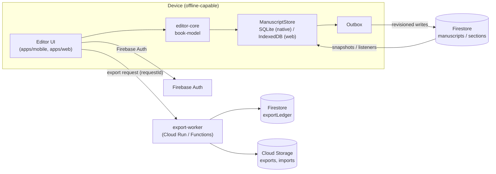
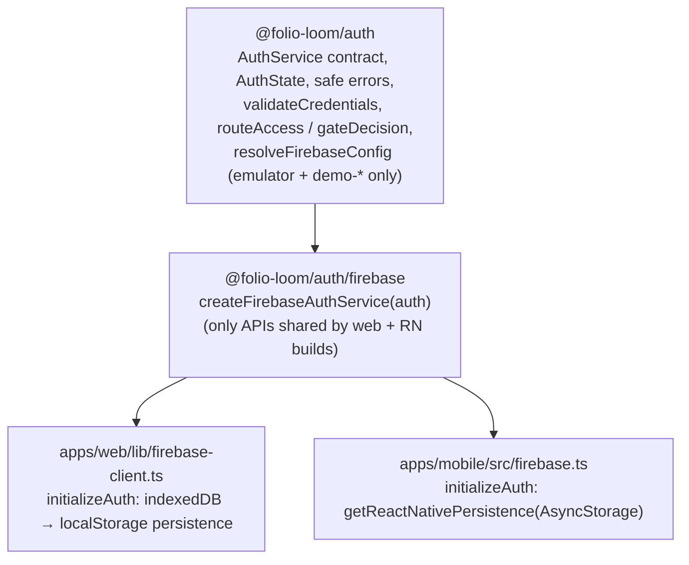

# Folio Loom 2.0 system design

## Goals

These constraints are fixed:
- Phone-first native iOS and Android apps, plus a responsive web app.
- Accounts are mandatory, cloud sync works from launch, and editing works offline after sign-in.
- DOCX and TXT import, with automatic chapter detection that the author can correct.
- Editing of chapters, paragraphs, and inline formatting.
- Professional templates.
- EPUB 3 export and print-ready PDF export.
- A limited number of free exports, with unlimited exports on Pro.
- Secure ownership, autosave, and recovery.

Manuscript integrity takes priority over interface polish.

## Repository layout

The repository is an npm-workspaces monorepo. The legacy CRA app stays at the repository root until 2.0 replaces it; see ADR-001.

```text
apps/
  mobile/            Expo + React Native (iOS, Android)
  web/               Next.js App Router (responsive web)
packages/
  book-model/        Versioned canonical schema (zod), builders, serialization, plain-text views
  chapter-engine/    Chapter / part / front & back matter detection with provenance
  import-engine/     TXT import, legacy-book migration; `./docx` subpath (Mammoth) for DOCX
  validation/        Integrity checks, text-preservation checks, provisional import limits
  editor-core/       Pure immutable edit operations (move section, edit blocks, parts)
  formatting/        Trim sizes, printer-safe margins, typography settings
  export-epub/       XHTML generation and escaping (EPUB packaging next milestone)
  export-contracts/  Export request / ledger types and the allowance policy
  sync/              Revision comparison, content hashing, persistence + outbox interfaces
  auth/              Auth contract, safe errors, credential checks, route gate, emulator-only
                     config; `./firebase` subpath adapts a Firebase `Auth` instance
services/
  export-worker/     Server-side export admission + idempotent accounting
firebase/            firestore.rules, storage.rules, emulator test suites, test-only emulator config
qa/fixtures/         Small → very large DOCX/TXT manuscripts used by tests
tooling/             Shared tsconfig, Vitest configs, Firebase CLI + emulator scripts
```

Dependencies flow in one direction:

- `book-model` depends on nothing internal.
- `chapter-engine` depends on `book-model`.
- `import-engine` depends on `chapter-engine` and `validation`.
- The apps depend on any of the packages above.

Packages ship TypeScript source. The web app compiles them through `transpilePackages`, and Metro compiles them directly. Nothing under `packages/` may import React, React Native, DOM APIs, or Node-only modules, with one exception: `import-engine/docx`, which pulls in Mammoth. The mobile app must not import that subpath.

## Runtime architecture



- **Auth:** Firebase Auth. M1-A ships email/password against the emulator; Apple and Google sign-in come later. Every document lives under `users/{uid}/…`, and security rules restrict access to the owning `uid`. See "Authentication" below.
- **Local first:** the editor reads and writes the local `ManuscriptStore` only. Each save is durable before the UI shows it as saved. If a save fails, the UI says so; it is never ignored, which is where the legacy app went wrong.
- **Sync:** an outbox pushes changed units (the manuscript manifest or a single section) with the revision they were based on. See `sync-design.md`.
- **Import:**
  - TXT is imported on the device.
  - DOCX is imported in the web app and in the export/import worker. Native apps upload the file to Storage for server-side conversion until a native DOCX path is proven.
  - Every import runs a text-preservation check before anything is saved. An import that fails the check is not saved.
- **Export:** always server-side. The worker admits the request against the ledger (idempotent on `requestId`), renders from a specific revision, and stores the artifact. See `export-policy.md`.

## Key decisions

| Decision | Choice | Why |
| --- | --- | --- |
| Monorepo | npm workspaces, legacy app stays at root | No new package manager; Vercel config untouched; legacy keeps deploying |
| Schema | zod 4 strict objects, `schemaVersion` literal, migrations registry | Runtime validation on every load/sync boundary; unknown fields rejected, not silently stripped |
| Text model | Sections, then blocks, then runs with marks | Supports inline formatting, scene breaks, subheadings; diffable per section |
| IDs | Prefixed random IDs (`sec_…`, `blk_…`) | Stable across edits, reorders and devices; Firestore-safe |
| Lint | Biome (new dirs only) | Avoids replacing CRA's ESLint 8 binary in the hoisted root |
| Tests | Vitest 5 from `tooling/` | Fast, ESM-native, runs package tests against real fixtures |
| PDF | Server-side renderer (decision in export-policy.md) | Vector text, embedded fonts, correct trim and bleed; DOM pagination doesn't scale |

## Authentication



- **One contract, two platform setups.** Each app creates its own `Auth` with the right persistence and connects it to the emulator. The shared adapter only wraps `onAuthStateChanged`, sign-up, sign-in, and sign-out. The web app never imports React Native modules. The mobile app imports `getReactNativePersistence` from `@firebase/auth`, which Metro resolves to the package's `react-native` build. TypeScript can't select that build on its own (the package lists `types` before the `react-native` condition), so `apps/mobile/tsconfig.json` maps `@firebase/auth` to the RN declarations.
- **Persistence, verified rather than assumed:**
  - Web: IndexedDB, falling back to localStorage. Verified in a browser against `next dev` and the Auth emulator: register, reload (still signed in), sign out, reload (still signed out).
  - Native: `@firebase/auth` 1.13.7's RN persistence accepts async-storage `^2.2.0 || ^3.0.0` (Expo SDK 57 pins 2.2.0). `rn-session-restoration.emulator.test.ts` drives the RN build through sign-up, a simulated app restart (restored), sign-out, and another restart (signed out). The iOS export bundle contains `getReactNativePersistence` and not the browser IndexedDB store.
  - Not yet verified on a simulator or physical device. That needs Xcode or Android Studio.
- **States.** `loading` until Firebase reports the restored session, then `signedIn`, `signedOut`, or `error`. The UI never treats `loading` as signed out or signed in.
- **Gate.** `routeAccess` classifies paths: `/projects/**` and `/manuscripts/**` are private; `/sign-in` and `/sign-up` are guest-only. `gateDecision` maps state and access to show-loading, show-error, redirect, or render.
  - On the web, private screens are client components rendered through a function child only once the state is `signedIn`. The server snapshot is always `loading`, so prerendered HTML and the RSC payload contain the loading view, never manuscript content. Don't pass server-rendered private content as `children` to `RequireAuth`, because it would be serialized into the RSC payload.
  - The Expo app's only screen is private and goes through the same `gateDecision`.
- **Errors.** Firebase error codes map to a fixed set of messages. Wrong password, unknown account, and similar errors share one message, so the form doesn't reveal which emails are registered. Raw SDK messages are never shown.
- **`?next=` redirect** accepts only same-site paths (`/x`, not `//host` or absolute URLs).

## Security rules

Rules live in `firebase/` and are tested against the emulators (`npm run ws:test:emulators`).

**Firestore data model** (all client-visible data under `users/{uid}`):

| Path | Client access (only when `request.auth.uid == uid`) |
| --- | --- |
| `users/{uid}` | get, create, update `displayName`/`updatedAt` only. No delete; account deletion is a server flow that must also remove Storage files |
| `…/manuscripts/{id}` | get, list, create (revision 1), update (revision + 1), delete |
| `…/manuscripts/{id}/sections/{id}` | Same, and the parent manuscript must exist and be owned on create |
| `…/manuscripts/{id}/snapshots/{id}` | get, list, create, delete. Never update; `storagePath` must point inside the owner's own snapshot folder |
| `…/entitlements/*`, `…/exportLedger/*`, `…/exports/*` | get, list only. Written by trusted servers (Admin SDK) |
| `billing/**`, `admin/**`, anything else | Denied |

- Every client-writable document has an `ownerId` equal to the path `uid`, checked on create, and it can't be changed on update.
- Documents use `keys().hasOnly([...])` allow-lists, so clients can't add `plan`, `isPro`, `isAdmin`, quota counters, or other unknown fields.
- There are no collection-group rules, so cross-account queries are denied.
- The `revision` rule backs the sync design: a write based on a stale revision is rejected, never merged.

**Storage paths:**

| Path | Client access (owner only) |
| --- | --- |
| `users/{uid}/imports/{file}` | get, list, create (DOCX ≤ 50 MB or `text/plain` ≤ 20 MB, non-empty), delete |
| `users/{uid}/manuscripts/{id}/snapshots/{file}` | get, list, create (`application/json` or `application/gzip` ≤ 25 MB), delete |
| `users/{uid}/exports/{exportId}/{file}` | get, list only. The export worker writes these |
| anything else | Denied |

- Uploads must carry `customMetadata.ownerId` equal to the path `uid`.
- Files are immutable. Storage evaluates a re-upload to an existing path as `create`, so create rules also require `resource == null`. Metadata updates are not allowed.

**Assumptions and limits:**

- After sign-out or account deletion, the client SDK drops its token immediately, and the tests confirm requests are then denied. An ID token that was already copied elsewhere stays valid until it expires (≤ 1 hour). Revoking sessions needs the Admin SDK (`revokeRefreshTokens`) and a server check, which is out of scope here.
- Email verification isn't required for access yet (`emailVerified` is exposed on `AuthUser` for later use).
- Rate limiting and abuse protection rely on Firebase Auth defaults until App Check is added.
- Size limits mirror `validation/IMPORT_LIMITS` and are provisional.

## Security baseline

- No credentials in the repo. `.gitignore` blocks service-account JSON, `google-services.json`, `GoogleService-Info.plist`, and `.env` files. Config comes from environment variables or EAS secrets.
- Local development and tests use only the Firebase Emulator Suite with a `demo-*` project ID. App code refuses any other mode or project ID.
- Firestore and Storage rules: owner-only, default deny, server-only entitlements, export ledger, and export artifacts (see "Security rules").
- No HTML is ever stored. Rendering escapes all text (`export-epub/escapeXml`).
- Import limits are enforced before parsing (`validation/IMPORT_LIMITS`, provisional).
